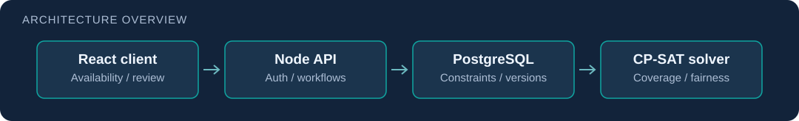

# PlanLi Schedule

**Collaborative shift planning: availability and staffing rules become editable, versioned schedules.**

A team project by **Roy Naor, Dor Cohen, Ofek, and Baruh Ifraimov**. It began as a hackathon prototype and evolved into a scheduling system with React, Node/Express, PostgreSQL, Firebase Authentication, and a Python OR-Tools CP-SAT solver.

## Implemented workflow

- Staff submit availability and scheduling constraints through the application.
- Managers maintain workers, worker types, planning periods, and shift requirements.
- The API persists constraints and scheduling state and calls the Python optimization service.
- Plans can be reviewed, adjusted, versioned, and published.

The current code includes **monthly planning and arrangement eligibility/state handling** alongside the earlier weekly routes. Read `server/src/routes.ts`, the current scheduling services, and the migration chain for the actual contract; the earlier design sketches are historical context.

## Contributions

This is a shared implementation. Dor's traceable contributions include [monthly scheduling with tests](https://github.com/RoyNaor/PlanLi-Schedule/commit/8c5e52a538a4aac400ee7951b2970a435ec20ff6), [eligibility and state handling](https://github.com/RoyNaor/PlanLi-Schedule/commit/8861d5efc53a3c5e063acb742aa3bd91dcf8aa0c), and [worker-type management](https://github.com/RoyNaor/PlanLi-Schedule/commit/c7e8ad246d42b343faeae6cdd98e9b9cac551a38). See the [full contributor history](https://github.com/RoyNaor/PlanLi-Schedule/graphs/contributors) for the team's work.

## Reviewer guide

| Area | Start here |
| --- | --- |
| React client | [client/src](client/src/) |
| API contract and authorization | [server/src/routes.ts](server/src/routes.ts) |
| Persistence and schema evolution | [server/migrations](server/migrations/) |
| CP-SAT solver and payloads | [solver/README.md](solver/README.md) |
| Setup, environment, API details, and test commands | [Development guide](docs/DEVELOPMENT_GUIDE.md) |

## Local development

Supply your own PostgreSQL database, Firebase project credentials, and the environment variables described in the [development guide](docs/DEVELOPMENT_GUIDE.md). Do not commit local secrets.

Run migrations and the Node server from `server/`, start Vite from `client/`, and start `solver/solver_service.py` from `solver/`. The usual local services are the client on **5173**, API on **3000**, and solver on **8080**. Calendar sync requires additional OAuth settings when enabled.

## Scope and limitations

The repository demonstrates constraint modeling, service integration, and collaborative product engineering. A feasible schedule depends on the supplied constraints and staffing data. No quantified fairness gain, customer adoption, or production availability is asserted by this documentation.

The detailed guide preserves the previous setup/API documentation, including historical weekly examples. When examples differ from the current monthly implementation, the router, services, migrations, and solver contract are authoritative.
