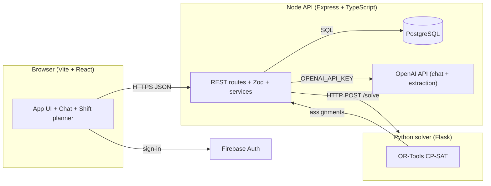

# PlanLi

<div align="center">

**AI-assisted staff scheduling for medical and clinical teams**

[Architecture](#architecture) · [Quick start](#quick-start) · [API](#api-overview) · [Testing](#testing-and-quality) · [Conventions](#versioning-commits-and-team-conventions) · [Contributing](#contributing)

[](https://react.dev/)
[](https://www.typescriptlang.org/)
[](https://vitejs.dev/)
[](https://expressjs.com/)
[](https://www.postgresql.org/)
[](https://www.python.org/)
[](https://developers.google.com/optimization)

</div>

---

**PlanLi** (branded *PlanLI* in the app UI) is a **monorepo** for an AI-assisted **medical / clinical staff scheduling** web application. It combines:

| Layer | Technology | Responsibility |
| ----- | ---------- | --------------- |
| **Web client** | Vite, React, TypeScript, Tailwind | Firebase sign-in, chat-based constraint capture, week and shift planning, schedule review, “my schedule” view |
| **API** | Node.js, Express, Zod, `pg` | Auth via Firebase Admin, business rules, PostgreSQL, OpenAI chat and constraint extraction, solver orchestration |
| **Scheduler** | Python, Flask, OR-Tools (CP-SAT) | `POST /solve` microservice: feasible / infeasible results, assignments, metadata |

> **Scope of this document:** it describes the **current `main` branch** in this repository. The older “minimal implementation / recommended next fixes” framing from early drafts is **out of date**—core flows (authentication, chat with structured constraint extraction, weeks and shifts, and solver integration) are implemented. Gaps in **automation** (for example, continuous integration) are called out explicitly below.

---

## Table of contents

- [Why PlanLi](#why-planli)
- [Highlights](#highlights)
- [Quick start](#quick-start)
- [Architecture](#architecture)
- [Project layout](#project-layout)
- [Prerequisites](#prerequisites)
- [Configuration](#configuration)
- [Run locally (detailed)](#run-locally-detailed)
- [Data model and migrations](#data-model-and-migrations)
- [API overview](#api-overview)
- [Python solver service](#python-solver-service)
- [Testing and quality](#testing-and-quality)
- [Versioning, commits, and team conventions](#versioning-commits-and-team-conventions)
- [Contributing](#contributing)
- [Project vision and roadmap (non-binding)](#project-vision-and-roadmap-non-binding)
- [Additional documentation](#additional-documentation)
- [Authentication flow](#authentication-flow)
- [Legacy reference: early API design sketches](#legacy-reference-early-api-design-sketches)
- [License](#license)

---

## Why PlanLi

- **Conversational input:** Planners and staff express availability and preferences in **natural language**; the system turns that into **structured, time-bounded** constraints.
- **Optimization-backed rosters:** A dedicated **CP-SAT** service tries to build feasible schedules under coverage and rule constraints, with a clear **infeasible** path when no solution exists.
- **Single source of truth in PostgreSQL:** Migrations in `server/migrations/` define the schema; the API is the **contract** for clients and the solver integration.

---

## Highlights

- **Conversational constraints:** Staff describe availability or preferences in **natural language**; the backend uses the **OpenAI** API (model `gpt-4o-mini` in code) to classify intent and extract **structured, time-bounded** constraints, stored in PostgreSQL.
- **Operational scheduling:** **Weeks** and **shifts** are first-class. Admins or planners model demand (minimum doctors / nurses per shift) and can **lock** a week, **queue a solver run**, **review** generated versions, and **publish** a schedule.
- **CP-SAT solver as a service:** A Python service exposes `POST /solve` and the Node server calls it when a solve is requested (asynchronous run tracking in the database).
- **My schedule (published):** Authenticated users can read their **published** assignment view once a version is published (see [API overview](#api-overview)).

---

## Quick start

1. **PostgreSQL** – create a database; you will set `DATABASE_URL` in `server/.env` (see [Configuration](#configuration)).
2. **Server** – `cd server && npm install && npm run migrate && npm run dev` (default API port from `PORT` in `.env`, **3000** in examples).
3. **Client** – `cd client && npm install && npm run dev` (Vite, typically **5173**).
4. **Solver** – `cd solver`, create a venv, `pip install -r requirements.txt`, run `python solver_service.py` (default **8080**). Point `SOLVER_SERVICE_URL` in `server/.env` at that base URL.

For full steps, environment variables, and health checks, see [Run locally (detailed)](#run-locally-detailed) and [Configuration](#configuration).

---

## Architecture

The system is split into **three** independently runnable parts:

1. **Web client** (browser) – talks to the Node API with `Authorization: Bearer <Firebase ID token>`.
2. **Node API** – verifies Firebase tokens, owns **business rules**, persistence, and **OpenAI** chat extraction; **does not** embed OR-Tools directly.
3. **Python solver** – receives normalized users, shifts, and constraints; returns **feasible** or **infeasible** results plus assignments and metadata.



---

## Project layout

| Path | Role |
| ---- | ---- |
| `client/` | Vite + React 19 + TypeScript + Tailwind. Primary UI, Firebase client SDK, calls `http://localhost:3000/api` in code. |
| `server/` | Express 5, TypeScript, `pg` driver, `zod` validation, `firebase-admin`, `openai`. **SQL migrations** in `server/migrations/`. |
| `solver/` | Flask + OR-Tools; HTTP API (`GET /health`, `POST /solve`). Listens on **port 8080** by default. See `solver/README.md`. |
| `Convention agreement - PlanLi.txt` | **Team Git workflow, semantic versioning, and commit message conventions** (source of truth for human process). |
| `AGENTS.md` | **Repository-level notes for AI coding agents** (optional tooling; not part of the runtime). |

> **Not shipped in this repository today:** a checked-in `LICENSE` file, GitHub Actions workflows, and Docker/Compose. Adding them is welcome—update this README in the same change so newcomers stay accurate.

---

## Prerequisites

- **Node.js** `>= 20.19.0` (enforced in `client/package.json` and `server/package.json` `engines` fields)
- **PostgreSQL** reachable via a `DATABASE_URL` connection string
- **Python 3** for the solver (3.10+ recommended; use the version you run `ortools` on successfully)
- **Firebase project** for client authentication and server-side token verification
- **OpenAI API key** (server-side) for the chat/constraint pipeline

---

## Configuration

### Server (`server/.env`)

Copy from `server/.env.example` and set at least:

- `DATABASE_URL` – PostgreSQL connection string (any managed Postgres, including self-hosted, works as long as the connection string is valid)
- `OPENAI_API_KEY` – used by the chat service
- `FIREBASE_SERVICE_ACCOUNT_JSON` **or** `FIREBASE_SERVICE_ACCOUNT_PATH` – **Firebase Admin** credentials for verifying ID tokens
- `FIREBASE_API_KEY`, `FIREBASE_AUTH_DOMAIN`, `FIREBASE_PROJECT_ID` – as referenced in the example; align with your Firebase console
- `SOLVER_SERVICE_URL` – base URL of the Python solver, for example `http://localhost:8080`
- `SOLVER_SERVICE_API_KEY` (optional) – if set, the Node server **adds** an `x-api-key` header on outbound calls to the solver. The **checked-in** `solver/solver_service.py` does **not** validate that header; use this only with a sidecar, reverse proxy, or if you extend the Python service to enforce it
- `SOLVER_REQUEST_TIMEOUT_MS` (optional, default in example: `60000`) – timeout for calls into the solver
- `GOOGLE_CALENDAR_CLIENT_ID` / `GOOGLE_CALENDAR_CLIENT_SECRET` – OAuth 2.0 client credentials for Google Calendar sync
- `GOOGLE_CALENDAR_REDIRECT_URI` – callback URL served by this API (`/api/calendar/google/callback`)
- `GOOGLE_CALENDAR_WEBHOOK_URL` – **must be a public HTTPS URL** pointing to `/api/calendar/webhook` for Google push notifications. In local dev (HTTP localhost) push is skipped; use an HTTPS tunnel (e.g. ngrok/cloudflared) if you want push.
- `GOOGLE_CALENDAR_STATE_SECRET` – secret used to sign and validate OAuth `state` payloads
- `GOOGLE_CALENDAR_WEBHOOK_URL` – public URL Google can call for webhook notifications (`/api/calendar/webhook`)
- `CALENDAR_TOKEN_ENCRYPTION_KEY` – 32-byte key (base64 or hex) used to encrypt refresh tokens and feed tokens at rest
- `WEBCAL_BASE_URL` – public base URL used when generating user WebCal feed links
- `CALENDAR_CHANNEL_RENEWAL_WINDOW_HOURS` (optional, default `48`) – renewal window for expiring webhook channels

**Security:** never commit real secrets (environment files with production keys, Firebase service account JSON, or similar). Use local env files and secret management appropriate to your environment.

### Client (Vite environment variables)

The client reads Firebase settings from Vite’s `VITE_` namespace (see `client/src/firebase.ts`):

- `VITE_FIREBASE_API_KEY`
- `VITE_FIREBASE_AUTH_DOMAIN`
- `VITE_FIREBASE_PROJECT_ID`
- `VITE_FIREBASE_APP_ID`

**Note on API base URL:** the current client code uses a fixed base `http://localhost:3000/api` in `client/src/services/auth.service.ts` (and similar call sites). For anything other than local development you will need to make that URL configurable; that change is not present in the repository at the time of writing.

---

## Run locally (detailed)

**1. Database**

Create an empty database and set `DATABASE_URL` in `server/.env`.

**2. Migrations (server)**

```bash
cd server
npm install
npm run migrate
```

**3. API server**

```bash
cd server
npm run dev
```

The API listens on `PORT` from `server/.env` (default **3000** per `server/src/index.ts` and `.env.example`).

**4. Web client**

```bash
cd client
npm install
npm run dev
```

Vite will print a local URL (port **5173** by default).

**5. Python solver** (required for `POST /api/weeks/:weekStart/solve` to succeed with a live model)

```bash
cd solver
python -m venv .venv
source .venv/bin/activate
pip install -r requirements.txt
python solver_service.py
```

The solver listens on `http://localhost:8080` (see `solver/solver_service.py`). Point `SOLVER_SERVICE_URL` at that base URL in `server/.env`.

**6. Calendar channel renewal job** (recommended if Google Calendar sync is enabled)

```bash
cd server
npm run calendar:renew-channels
```

Run this command daily via cron/scheduler in production so expiring Google webhook channels are re-registered.

---

## Data model and migrations

The **authoritative** schema is defined by the ordered SQL files in `server/migrations/`. The application gradually evolved; read migrations for exact `CREATE TABLE` / `ALTER` history.

**Conceptual model (simplified):**

- **users** – profiles keyed by stable IDs that align with **Firebase** identities after sync
- **conversations** and **messages** – chat history and assistant replies
- **constraints** – structured, time-bounded rules extracted or confirmed from chat, with support for all-day and timezone-aware storage (see **0004–0008, 0009** in migrations for evolution)
- **weeks** and **shifts** – planning entities for a schedule week, including lifecycle fields and publish metadata (**0010–0011, 0013**)
- **schedule_runs**, **schedule_versions**, **assignments** – track solver runs, versioned results, and staff-to-shift **assignments** with manual adjustment support and publish flags (**0012, 0013**)

> The SQL snippet that appeared in very early documentation (`shifts_config`, `final_schedule`, and `seniority_level` on `users`) **does not** match the current migration chain. Treat migrations as the source of truth, not the historical README sketch.

---

## API overview

**Public or health (no auth):**

- `GET /` – simple JSON status
- `GET /api/health` – liveness
- `GET /api/health/database` – database check (the JSON includes a `provider` field that is **hard-coded** in the controller; it is **not** a live probe of your hosting vendor)
- `GET /api/version` – `service`, `version` (from `npm_package_version` when running via npm, else `"unknown"`), and Node.js version

**Authenticated (`Authorization: Bearer <Firebase ID token>`):**

- **User sync and management:** `POST /api/users/sync`, `GET /api/users/me`, `GET/POST/PUT/DELETE` under `/api/users/...` (listing and most mutations require the authenticated user to have the **`admin`** role – see `server/src/controllers/user.controller.ts` and the `requireAdmin` helper)
- **Chat:** `POST /api/chat`, `GET /api/chat/:userId`
- **Weeks and shifts:** `GET/POST /api/weeks`, duplicate week, open constraint collection, lock, delete, plus shift CRUD under `/api/shifts/...` (see `server/src/routes.ts`)
- **Solving and schedules:** `POST /api/weeks/:weekStart/solve`, list runs, fetch run by id, list/get schedule versions, publish a version, add/remove assignments, and summary endpoints like `/api/weeks/:weekStart/constraints-summary` and `GET /api/my-schedule`

For a **single** consolidated list, open `server/src/routes.ts` – that file is the **canonical route map**.

---

## Python solver service

- **Entrypoint:** `solver/solver_service.py` (Flask, OR-Tools CP-SAT)
- **Default listen address:** `0.0.0.0:8080`
- **Endpoints:** `GET /health`, `POST /solve`
- **Tests:** `solver/test_solver_service.py` (unittest)

Run tests from the `solver` directory, for example:

```bash
cd solver
source .venv/bin/activate
python -m unittest test_solver_service
```

For payload shape and example JSON, use `solver/README.md` in this repository (it is maintained next to the code).

---

## Testing and quality

| Area | Command (from the matching directory) |
| ---- | --------------------------------------- |
| **Server** unit tests | `cd server && npm test` (uses Node’s test runner, see `server/package.json`) |
| **Server** typecheck | `cd server && npm run typecheck` |
| **Server** calendar channel renewal check | `cd server && npm run calendar:renew-channels` |
| **Client** typecheck | `cd client && npm run typecheck` |
| **Client** lint | `cd client && npm run lint` |
| **Solver** | `cd solver && python -m unittest test_solver_service` |

**Continuous integration:** there is no `.github/workflows` directory in the repository at present, so you do not get out-of-the-box GitHub CI until you add it.

---

## Versioning, commits, and team conventions

- **App versions** in this repo: `client/package.json` and `server/package.json` each expose a `"version"` field. Keep them **aligned** with your release and with team rules in `Convention agreement - PlanLi.txt` when you use that workflow.
- **Human process and Git workflow** (branching, PRs to `main`, **semantic** `X.Y.Z`, and commit message **sections**): see **`Convention agreement - PlanLi.txt`**. That text is the **team’s convention agreement**; it is not enforced by the application runtime.
- **Optional local Git hooks:** if your clone includes a `.githooks/` directory, you can point Git at it with `git config core.hooksPath .githooks` for extra checks (for example, blocking direct commits to `main` or validating commit message shape). This is a **per-machine** opt-in; see `AGENTS.md` for how the project expects agents and contributors to use it.
- **AI agent guidance:** see `AGENTS.md` (optional).

---

## Contributing

- Read **`Convention agreement - PlanLi.txt`** for **branching**, **pull requests to `main`**, **semantic versions** `X.Y.Z`, and the **commit message** layout the team uses.
- Before opening a PR, run the **relevant** checks from [Testing and quality](#testing-and-quality) for the areas you changed (server, client, solver).
- **Canonical API surface:** `server/src/routes.ts` and SQL in `server/migrations/`. If you add routes or schema, update this README in the same change.
- **AI-assisted development:** `AGENTS.md` describes optional agent workflows (tooling, not runtime behavior).

---

## Project vision and roadmap (non-binding)

**Vision** (product direction, not a guarantee of what is already shipped in the UI):

- Collect **natural-language** schedule constraints and translate them into **machine-checkable** rules.
- Combine **soft** and **hard** constraints, **coverage requirements**, and fairness considerations into a single **optimization** problem.
- Emit **defensible, editable** rosters, not only a black-box grid.

**Roadmap / improvement ideas that are *not* implied to exist in code yet:**

- First-class **CI** on Git pull requests (`typecheck`, `lint`, server tests, solver unit tests)
- A **configurable** API base URL for the client and environment-specific build pipelines
- Rich **analytics** surfaces (KPIs, constraint satisfaction percentages, and fairness visualizations) if product owners specify metrics

**Calendar UI note:** the older README mentioned `react-big-calendar`. That **package is not** a dependency in `client/package.json`. Week and shift **visual planning** in this repository uses **custom** React components (for example, files under `client/src/components/shifts/` and related pages).

---

## Additional documentation

- **`solver/README.md`** – solver API contract and examples (kept close to the Python code).
- **`AGENTS.md` / `Convention agreement - PlanLi.txt`** – people and tool workflows, not application behavior.

---

## Authentication flow

1. A user signs in on the **web client** with **Firebase Auth** (email/password in the current UI).
2. The client keeps the **Firebase ID token** and includes it in API requests.
3. Every protected call uses the header:

   ```http
   Authorization: Bearer <firebase_id_token>
   ```

4. The **Node** server uses **Firebase Admin** to **verify** the token and to derive the `uid` / profile, then authorizes data access in controllers and services.

---

## Legacy reference: early API design sketches

The following JSON examples are **architectural sketches** that informed design discussions. The **current** public HTTP map is the Express router in `server/src/routes.ts`. Endpoints and names like `POST /api/analyze-text` or `POST /api/solve-schedule` are **not** the routes the server exposes today, but the **intent** (analyze text, persist constraints, return assignments) is reflected in the implemented chat, constraint, and schedule routes above.

**Conceptual: analyze / extract a constraint**

**Request**

```json
{
  "text": "I can't work Tuesday evening",
  "user_id": "abc123"
}
```

**Response (illustrative)**

```json
{
  "start_time": "2026-03-03T18:00:00Z",
  "end_time": "2026-03-03T23:00:00Z",
  "constraint_type": "HARD",
  "weight": 80
}
```

**Conceptual: run a multi-day schedule solve**

**Request**

```json
{
  "start_date": "2026-03-01",
  "end_date": "2026-03-07"
}
```

**Response (illustrative)**

```json
[
  {
    "shift_id": 1,
    "user_id": "abc123"
  }
]
```

---

For details that depend on *your* deployment (exact URLs, infrastructure, and hardening), treat the **code** and **migrations** as the contract, and keep this file updated in the same change when behavior or setup changes.

---

## License

There is **no** `LICENSE` file in the repository at present. If you add one, place it in the **repository root** and add a one-line **License** subsection here (or a dedicated `LICENSE` section) in the same commit so the public-facing entry point stays honest.
